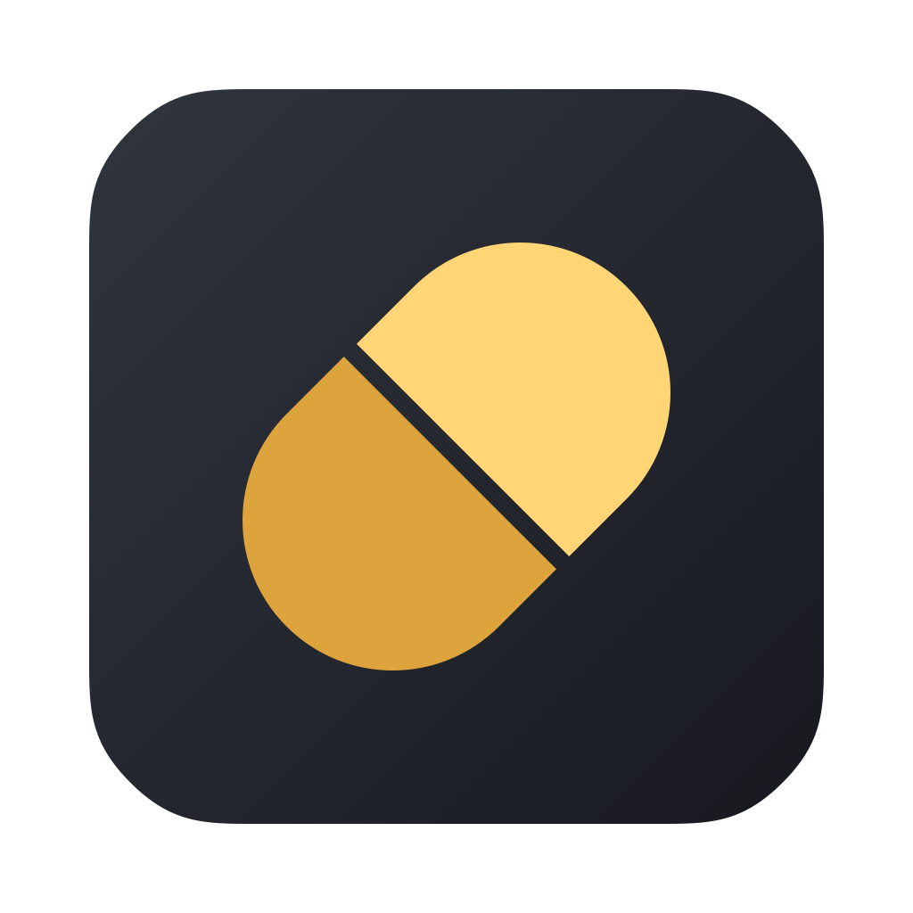

<p align="center">
  
</p>

<h1 align="center">Lisdex</h1>

<p align="center">
  A tiny, open-source macOS menu bar app that keeps your Mac awake.<br>
  Indefinitely, for a duration, or on a schedule.
</p>

<p align="center">
  <a href="https://github.com/sponsors/pedrol2b"></a>
  
  
</p>

> **Status:** in development. The design is final and v1.0 is being built. The install commands below go live with the first release.

## Why does this exist?

My company laptop blocks [Amphetamine](https://apps.apple.com/app/amphetamine/id937984704) from the App Store, so I built my own.

Lisdex does one thing: stop your Mac from going to sleep. It's small enough to read in an afternoon, so you can check exactly what you're running.

### Why "Lisdex"?

**Lisdex** is short for **lisdexamfetamine** ([PubChem CID 11597698](https://pubchem.ncbi.nlm.nih.gov/compound/Lisdexamfetamine)), hence the capsule pill icon. Amphetamine is named after a drug, so this one is too. Lisdexamfetamine is the active ingredient of Vyvanse/Elvanse, which are trademarks of their owners. Lisdex isn't affiliated with them and has nothing to do with medicine.

## Features

| | |
| --- | --- |
|  →  | **Menu bar only.** No Dock icon. A capsule pill, outlined when inactive and filled when active. Prefer a coffee mug? It's one setting away. |
| ∞ | **Indefinitely.** Stay awake until you turn it off. |
| ◷ | **For a duration.** 15 min, 30 min, 1 h, 2 h or a custom time. |
| ▦ | **On a schedule.** Choose days and hours, e.g. weekdays 09:00–18:00. |
| 🖱 | **Left-click** opens the menu. **Right-click** toggles Keep Awake and keeps your selected mode. |
| ⚙︎ | Start on login, keep the display awake, a battery cutoff, accent colours and two icon variants. |

### How it keeps your Mac awake

By default Lisdex uses macOS **power assertions** (IOKit), the same mechanism `caffeinate` uses. They show up as `Lisdex` in `pmset -g assertions`, and macOS clears them automatically if the app quits or crashes. If you prefer the system command, you can switch to `/usr/bin/caffeinate` in **Settings → Power**.

## Install

Lisdex is **built on your Mac from source**. There is no prebuilt download (see [why](#why-build-from-source)).

### Requirements

- macOS 14 Sonoma or later (Apple silicon or Intel)
- Xcode Command Line Tools with Swift 6: `xcode-select --install`
- [Homebrew](https://brew.sh) (only for option 1)

### Option 1 — Homebrew (recommended)

```sh
brew install pedrol2b/tap/lisdex
ln -sf "$(brew --prefix)/opt/lisdex/Lisdex.app" ~/Applications/Lisdex.app
open ~/Applications/Lisdex.app
```

Homebrew downloads the source, compiles it (takes about a minute) and installs `Lisdex.app`. The link puts it in `~/Applications` so Spotlight and Login Items can find it. Update with `brew upgrade lisdex`.

### Option 2 — Build it yourself

```sh
git clone https://github.com/pedrol2b/lisdex.git
cd lisdex
make install   # builds, signs locally and copies Lisdex.app to ~/Applications
```

### Why build from source?

macOS only opens downloaded apps if they're **signed and notarized with a paid Apple Developer account** (US$99/year). This project doesn't have one. Without it:

- a prebuilt `Lisdex.app` from GitHub Releases would be blocked by Gatekeeper as "damaged" or "from an unidentified developer";
- Homebrew's official cask repository no longer accepts unsigned apps, and Homebrew removed the `--no-quarantine` workaround.

An app **compiled on your own Mac** is never quarantined, so Gatekeeper lets it run with no warnings and no security settings to disable. The Homebrew tap uses a *formula* that builds from source for this reason, rather than a *cask* that downloads a binary.

On a company-managed Mac, device-management policy may still block locally built apps. Please respect your organisation's rules.

> 💛 **Want one-click installs?** Signed, notarized releases (and an official Homebrew cask) need an Apple Developer membership. If you'd like to help make that happen, by [sponsoring](https://github.com/sponsors/pedrol2b) or by contributing signing/notarization CI for a future maintainer account, contributions are very welcome. Open an issue to discuss.

## Uninstall

```sh
brew uninstall lisdex && rm ~/Applications/Lisdex.app   # Homebrew
rm -rf ~/Applications/Lisdex.app                          # built yourself
defaults delete io.github.pedrol2b.lisdex                  # optional: remove settings
```

## Contributing

Issues and PRs are welcome! Read the [contributing guide](CONTRIBUTING.md) and the [code of conduct](CODE_OF_CONDUCT.md) first. Found a vulnerability? Please follow the [security policy](SECURITY.md) instead of opening an issue.

The project is a SwiftPM package (no Xcode project): `make test` runs the unit tests, `make run` builds and launches the app. Design notes, decisions (ADRs) and the roadmap are in [`.context/`](.context/README.md). Start with [`AGENTS.md`](AGENTS.md).

## Sponsor

If Lisdex keeps your Mac (and you) awake, consider supporting it. Sponsorships go towards an Apple Developer membership for signed releases.

- [GitHub Sponsors](https://github.com/sponsors/pedrol2b)
- [Patreon](https://www.patreon.com/pedrol2b)
- [Buy Me a Coffee](https://buymeacoffee.com/pedrol2b)

## License

[MIT](LICENSE) © 2026 Pedro Bueno
